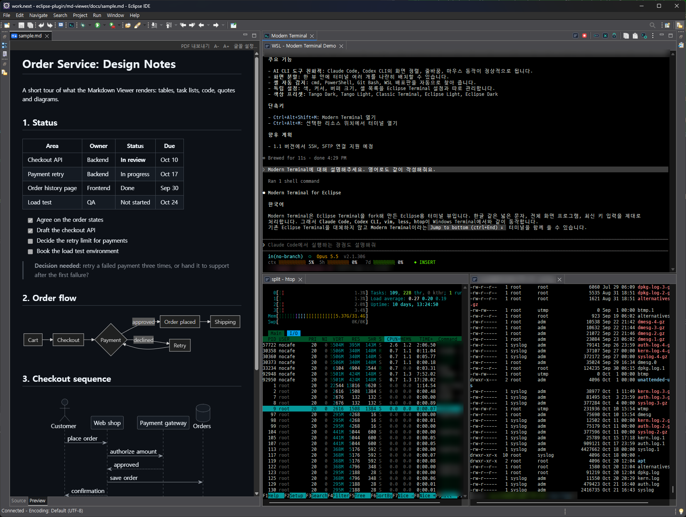

# Modern Terminal for Eclipse

[English README](README.md)



| 한글을 출력하는 Claude Code | 위 Claude Code, 아래 htop |
|---|---|
|  |  |

Eclipse용 터미널 뷰.
한글 등 넓은 문자, 전체 화면 프로그램, 최신 키 입력을 제대로 처리: Claude Code, Codex CLI, vim, less, htop이 Windows Terminal과 같이 동작.
Eclipse Terminal을 fork한 것으로, 별도 뷰 **Modern Terminal**로 기존 터미널 옆에 설치됨.

## 개선·추가 내용

| | Eclipse Terminal | Modern Terminal |
|---|---|---|
| 한글·중국어·일본어 | 1칸으로 계산: 줄이 깨지고 커서가 밀림 | 다른 터미널과 같이 2칸 (East Asian Width) |
| 이모지·결합 문자 | 쪼개지거나 겹침 | 하나의 글자 묶음(grapheme cluster)으로 표시 (ZWJ 이모지, 국기, 피부색, 악센트) |
| 전체 화면 프로그램 (vim, less, htop, Claude Code) | 스크롤 기록 위에 그려 잔상이 남음 | 대체 화면 버퍼: 종료하면 셸 화면이 그대로 돌아옴 |
| 마우스 | 프로그램에 전달 안 됨 | 요청한 프로그램에 전달 (클릭, 휠, 드래그, SGR 방식) |
| DEC 모드, 브래킷 붙여넣기, 커서 숨김, 흐린 글자 | 일부만 | 지원 |
| Shift+Enter | 바로 실행 | Claude Code·Codex 등에서 줄바꿈 (웹과 같은 습관) |
| 명령 입력창 | 한 줄 | 여러 줄 (Shift+Enter), 기록 유지 |
| 탭 | 뷰마다 한 줄 | 탭을 가장자리로 끌어 화면 분할, 재시작 후 배치 복원 |
| Ctrl+클릭 | URL과 단순 파일 경로 | 괄호·따옴표·백틱 안 경로, Windows 절대 경로, WSL 경로(`/mnt/c/...`, `/home/...`), 한글 경로도 열기 |
| 파일 끌어 놓기 | 지원 안 함 | 경로 입력, 셸에 맞게 따옴표 처리 (bash, cmd, PowerShell) |
| 색 | 글자색을 시스템에서 가져옴: 다크 테마에서 거의 검정 | Tango 기반, Eclipse 테마에 맞춤, Tango Dark·Light·Classic 프리셋 |
| 기본값 | 블록 커서, 1000줄 | 세로 막대 커서, 선택 시 복사, 10000줄 |

- 현재는 로컬 셸만 지원 (cmd, PowerShell, Git Bash, WSL 배포판은 시작 시 자동 감지)
- SSH, SFTP는 1.1에서 추가 예정

## 요구 사항

- Eclipse 2026-09 (4.41)에서 확인, 2026-06 (4.40)도 동작 예상, Java 21 이상
- Eclipse Terminal이 들어 있는 Eclipse IDE 패키지 (PTY 라이브러리 `org.eclipse.cdt.core.native` 사용)
- Windows 10/11, Linux에서 확인 (macOS는 미확인)

## 설치

- 업데이트 사이트: Help → Install New Software → Work with에 `https://insjang.github.io/eclipse-modern-terminal/updates/` 입력 → Modern Terminal 체크 → 설치 → 재시작
  - 코드 서명이 없어 신뢰 여부를 물음: Trust Selected
  - 이후 Help → Check for Updates로 업데이트
- 열기: Window → Show View → Other... → Modern Terminal, 또는 Ctrl+Alt+Shift+M
  - Ctrl+Alt+M: 선택한 리소스 위치에서 터미널 열기
  - 두 터미널을 함께 설치할 수 있도록 Eclipse Terminal의 단축키(Ctrl+Alt+Shift+T, Ctrl+Alt+T)와 다르게 지정
- 제거: Help → About Eclipse IDE → Installation Details → Installed Software → Modern Terminal → Uninstall

## 설정

- Preferences → Modern Terminal (하위에 Local Terminal)
- 색, 커서, 선택 시 복사, 버퍼 줄 수, 셸 목록은 Eclipse Terminal 설정과 별개
- Load Presets: Modern Terminal Defaults (Restore Defaults 값), Tango Dark, Tango Light, Classic Terminal (Eclipse Terminal 색), Eclipse Light, Eclipse Dark

## 빌드

```bash
ECLIPSE=/path/to/eclipse ./build.sh            # build/*.jar 생성, 단위 테스트 실행
ECLIPSE=/path/to/eclipse ./build.sh install    # $ECLIPSE/dropins 에 복사 (Eclipse 종료 상태에서)
ECLIPSE=/path/to/eclipse ./build.sh site       # build/site 에 p2 업데이트 사이트 생성
```

- JDK 21 이상, bash (WSL 가능)

## 출처와 라이선스

- [eclipse-platform/eclipse.platform](https://github.com/eclipse-platform/eclipse.platform)의 `terminal/` (ea81a95)을 fork
  - upstream에 제안한 PR 2894, 2899~2905, 2973, 2979의 변경과 이후 추가 기능 포함
- 패키지명은 `org.eclipse.terminal`에서 `io.github.insjang.terminal`로 변경
- Eclipse Public License 2.0, [LICENSE](LICENSE)와 [NOTICE](NOTICE) 참고

AI(Claude Code)의 도움을 받아 개발.
