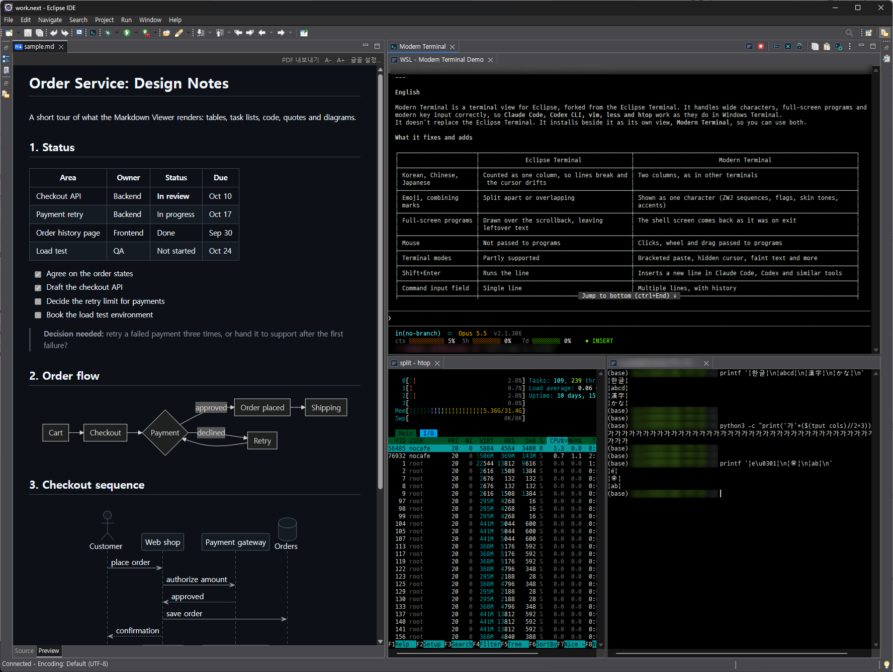
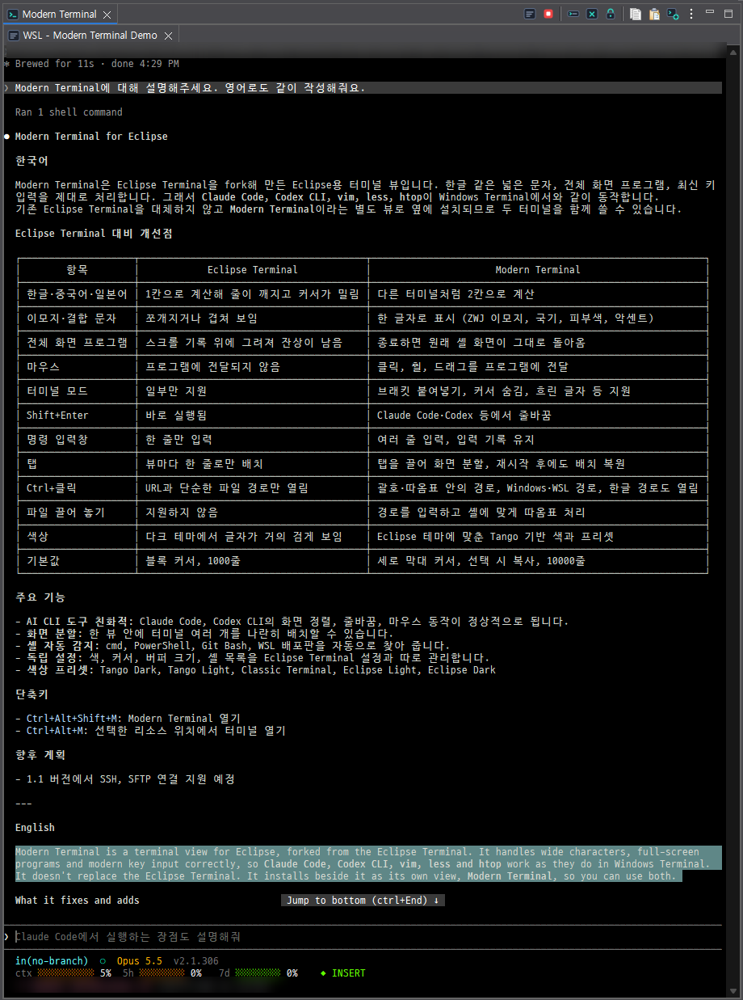
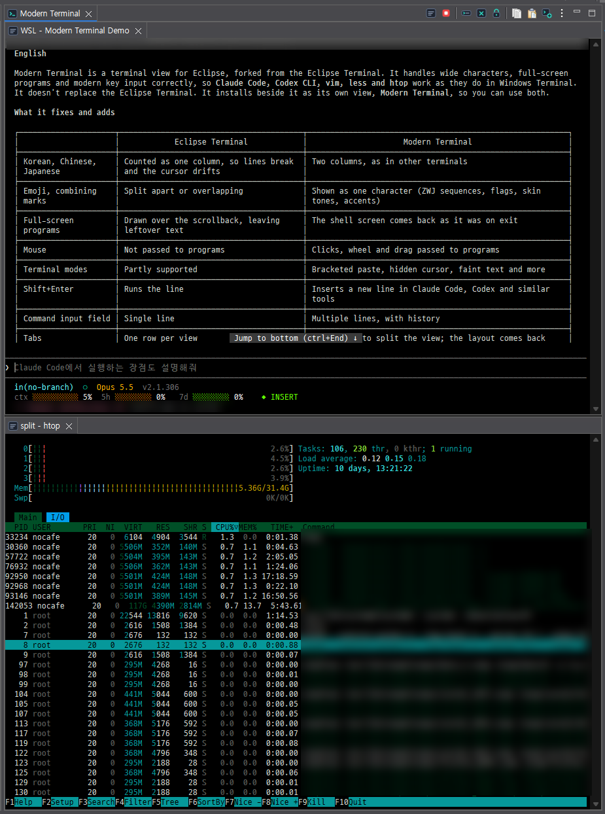

# Modern Terminal for Eclipse

A terminal view for Eclipse that gets wide characters, full-screen programs and modern key handling right, so that Claude Code, Codex CLI, vim, less and htop work as they do in Windows Terminal.
It is a fork of the Eclipse Terminal and installs beside it as its own view, **Modern Terminal**.

[한국어 README](README.ko.md)



| Claude Code with Korean text | Claude Code above, htop below |
|---|---|
|  |  |

## What it fixes and adds

| | Eclipse Terminal | Modern Terminal |
|---|---|---|
| Korean, Chinese, Japanese | counted as one column: lines break and the cursor drifts | two columns, as in every other terminal (East Asian Width) |
| Emoji, combining marks | split or doubled | one grapheme cluster in its cells (ZWJ sequences, flags, skin tones, accents) |
| Full-screen programs (vim, less, htop, Claude Code) | draw over the scrollback, leave garbage behind | alternate screen buffer: the shell comes back as it was |
| Mouse | ignored by programs | reported to programs that ask (click, wheel, drag; SGR mode) |
| DEC modes, bracketed paste, hidden cursor, faint text | partly | supported |
| Shift+Enter | runs the line | a new line in Claude Code, Codex and the like, as on the web |
| Command input field | one line | several lines (Shift+Enter), history kept |
| Tabs | one row per view | drag a tab to an edge to split the view; the layout comes back after a restart |
| Ctrl+click | URLs and plain file paths | also paths in brackets, quotes or backticks, absolute Windows paths, WSL paths (`/mnt/c/...`, `/home/...`), Hangul paths |
| Drop files | not supported | types their paths, quoted for the shell (bash, cmd, PowerShell) |
| Colors | text color from the system: near black on the dark theme | Tango based, matched to the Eclipse theme; Tango Dark/Light and Classic presets |
| Defaults | block cursor, 1000 lines | bar cursor, copy on select, 10000 lines |
| SSH | JSch 0.1.55 | Apache MINA SSHD, OpenSSH-style known_hosts, saved sessions |
| SFTP | none | Files view: browse, transfer, edit remote files in Eclipse, follows the shell's folder |

Local shells (cmd, PowerShell, Git Bash, WSL distributions, detected on start) and SSH.

## Requirements

- Eclipse 2026-09 (4.41), tested; 2026-06 (4.40) should work. Java 21 or later
- An Eclipse IDE package that has the Eclipse Terminal (for its PTY library, `org.eclipse.cdt.core.native`)
- Windows 10/11 and Linux; macOS should work but is not tested
- For SSH and the Files view: Apache MINA SSHD 2.19 or later in 2.x (`org.apache.sshd.osgi`, `org.apache.sshd.sftp`)
  - Every Eclipse IDE package with EGit has it (JGit uses it for SSH), e.g. the IDE for Java Developers and for Enterprise Java; Eclipse 2026-09 ships 2.19.0
  - Other packages: the install needs it from an enabled update site, such as the Eclipse release site `https://download.eclipse.org/releases/2026-09`

## Install

- Eclipse Marketplace: drag the button onto a running Eclipse, or search for "Modern Terminal" in Help > Eclipse Marketplace ([listing](https://marketplace.eclipse.org/content/modern-terminal))

  [](https://marketplace.eclipse.org/marketplace-client-intro?mpc_install=7574373 "Drag to your running Eclipse workspace to install Modern Terminal")

- Update site: Help > Install New Software > Work with `https://insjang.github.io/eclipse-modern-terminal/updates/` > check Modern Terminal > install > restart
  - The bundles are not signed, so Eclipse asks whether to trust them: Trust Selected
  - Later versions come with Help > Check for Updates
- Open it: Window > Show View > Other... > Modern Terminal, or Ctrl+Alt+Shift+M
  - Ctrl+Alt+M opens a terminal at the selected resource
  - The keys differ from the Eclipse Terminal's (Ctrl+Alt+Shift+T, Ctrl+Alt+T) so that both can be installed
- Uninstall: Help > About Eclipse IDE > Installation Details > Installed Software > Modern Terminal > Uninstall

## Preferences

Preferences > Modern Terminal (and Local Terminal under it).
Colors, cursor, copy on select, buffer lines and the shell list are separate from the Eclipse Terminal's.
Load Presets offers Modern Terminal Defaults (what Restore Defaults gives), Tango Dark, Tango Light, Classic Terminal (the Eclipse Terminal's colors), Eclipse Light and Eclipse Dark.

## SSH

- Ctrl+Alt+Shift+M (or Open Modern Terminal... in the view toolbar) > Choose terminal: SSH Terminal
  - Host, user, port, an optional key file, timeout and keepalive
- Saved sessions: pick one under Session, Save... stores the fields under a name, Delete removes it and its saved password
- Authentication, as OpenSSH tries it:
  - Keys: the key file field first, then `~/.ssh/id_ed25519`, `id_ecdsa`, `id_rsa` and `IdentityFile` entries of `~/.ssh/config`; a passphrase is asked when needed
  - Password and keyboard-interactive (e.g. one-time codes)
- Passwords are kept only when "Save password" is checked, and then only in the Eclipse Secure Storage
- Host keys are checked against `~/.ssh/known_hosts` like OpenSSH:
  - Unknown host: the fingerprint is shown, and the key is added if you accept
  - Changed key: the connection is refused; remove the old line from `known_hosts` if the change is expected

## Files view (SFTP)

Window > Show View > Other... > Modern Terminal > Modern Terminal Files.

- Shows the files of the SSH tab selected in Modern Terminal, on the same connection: no second login
- Browse, Upload... (or drop files and folders from the desktop), Download..., New Folder..., Rename..., Delete
- Double-click a file to open it in the Eclipse editor; saving uploads it
  - If the file has changed on the server since it was opened, you are asked before it is overwritten
  - Files that look binary are asked about first, since a text editor can damage them
  - Remote files are never opened in an external program
- Uploads are written to a temporary name and then renamed over the file, so a cancel or a dropped connection keeps the original
  - This needs the `posix-rename@openssh.com` extension (OpenSSH has it); without it the file is written in place

### Follow the shell's folder (OSC 7)

When the remote shell reports its current folder, the Files view follows the terminal as you `cd`.
Follow Terminal Folder in the view toolbar turns it off and on.
Nothing is injected into the remote shell: add one of these to the server's shell startup file.

bash (`~/.bashrc`):

```bash
# Modern Terminal: report the current folder (OSC 7) at every prompt
__mt_osc7() {
	local LC_ALL=C s=$PWD out= c i
	for ((i = 0; i < ${#s}; i++)); do
		c=${s:i:1}
		case $c in
		[-/._~A-Za-z0-9]) out+=$c ;;
		*) printf -v c '%%%02X' "'$c"; out+=$c ;;
		esac
	done
	printf '\e]7;file://%s%s\e\\' "$HOSTNAME" "$out"
}
PROMPT_COMMAND="__mt_osc7${PROMPT_COMMAND:+;$PROMPT_COMMAND}"
```

zsh (`~/.zshrc`):

```zsh
# Modern Terminal: report the current folder (OSC 7) at every prompt
__mt_osc7() {
	emulate -L zsh
	setopt extended_glob
	local LC_ALL=C
	printf '\e]7;file://%s%s\e\\' "$HOST" "${PWD//(#m)[^-\/._~A-Za-z0-9]/%${(l:2::0:)$(([##16]#MATCH))}}"
}
autoload -Uz add-zsh-hook
add-zsh-hook precmd __mt_osc7
```

Systems whose `vte.sh` already sends OSC 7 (Fedora, for example) need nothing.

## Build

```bash
ECLIPSE=/path/to/eclipse ./build.sh            # build/*.jar, and runs the unit tests
ECLIPSE=/path/to/eclipse ./build.sh install    # also copies the jars into $ECLIPSE/dropins (close Eclipse first)
ECLIPSE=/path/to/eclipse ./build.sh site       # also builds a p2 update site in build/site
```

JDK 21 or later and bash (WSL works).

## Source and license

Forked from [eclipse-platform/eclipse.platform](https://github.com/eclipse-platform/eclipse.platform) `terminal/` at ea81a95, with the changes proposed upstream in pull requests 2894, 2899 to 2905, 2973 and 2979, and more since.
Packages are renamed from `org.eclipse.terminal` to `io.github.insjang.terminal`.
Eclipse Public License 2.0; see [LICENSE](LICENSE) and [NOTICE](NOTICE).

Developed with the help of AI (Claude Code).
